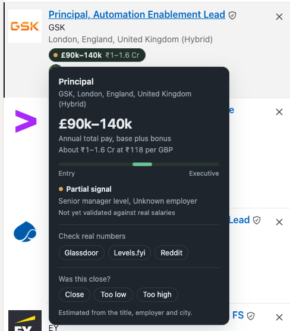

# Ballpark

**A Chrome extension that puts an estimated pay range on LinkedIn job listings.**

It does not know what anyone earns — no public source does. It estimates a market range for the *role* from the title, employer and city, runs entirely on your machine, and tells you how much to trust each estimate.


---

## What it does

A **pay badge** sits on each job row. Hover it and an **estimate card** opens with the reasoning behind the number.



Every card carries a signal state:

| State | Meaning |
|---|---|
| **Strong signal** | Role, seniority, employer and city all read cleanly |
| **Partial signal** | Something was missing — usually the employer isn't in the tier list |
| **No estimate** | Too little to go on. It shows nothing rather than guess. |

That last one is the point. A confident wrong number is worse than no number.

Each card also links out to Glassdoor, Levels.fyi and Reddit to check real figures, and has a **Was this close?** row so you can mark an estimate as too low or too high.


---

## How the estimate works

```
midpoint = base[role family][level] x city multiplier x employer tier x experience
range    = midpoint ± a spread that widens as confidence falls
```

A low-confidence read produces a visibly wider, less useful range rather than a falsely precise one. The inputs live in three editable JSON files — the role/level matrix, city multipliers and currencies, and employer tiers — so the model can be retuned without touching code.

---

## Privacy

| Data | Where it goes |
|---|---|
| Names, photos, profile URLs | Never leave the page. Not stored, not sent. |
| Role, employer, city | Stays local, unless you add your own API key for refinement |
| Everything else | Nowhere. No server, no analytics, no account. |

Site access is limited to `linkedin.com`. With no API key set, the Network tab shows no outbound requests at all. Nothing runs on page load or in the background — only when you hover.

---

## Install

No build step, no dependencies.

1. Download or clone this repo
2. Open `chrome://extensions` and turn on **Developer mode**
3. Click **Load unpacked** and select the folder containing `manifest.json`
4. Open LinkedIn job search

Settings are under **Details → Extension options**: display currency, hover delay, which surfaces are active, and cache controls.

---

## Limitations

This is a personal prototype, not a product, and not something to use in a real pay decision.

- The number describes a **role**, not a person. Two people with the same title at the same employer routinely differ by a wide margin.
- Senior roles are the weakest case. Senior people often write headlines full of achievements and no job title, so seniority falls back to a mid-level default and the estimate comes out low.
- Employer tiers are coarse and incomplete. An employer that isn't catalogued drops to a default tier and the card says so.
- The compensation matrix and FX rates are hand-maintained snapshots and drift.
- Estimates have not yet been validated against real reported salaries.

For real decisions use levels.fyi, AmbitionBox, Glassdoor, or a survey your employer licenses.

---

## What I'd build next

1. Read seniority from the experience section rather than the headline — fixes the biggest failure mode at its root
2. Market-anchored baselines instead of scaling one matrix by a city multiplier
3. Suppress precise figures below a confidence threshold, showing a band instead
4. Use the **Was this close?** feedback to calibrate against reality

---

*Built with Claude. Vanilla JavaScript, Manifest V3, no dependencies, no build step.*
